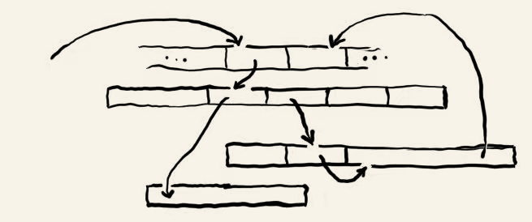
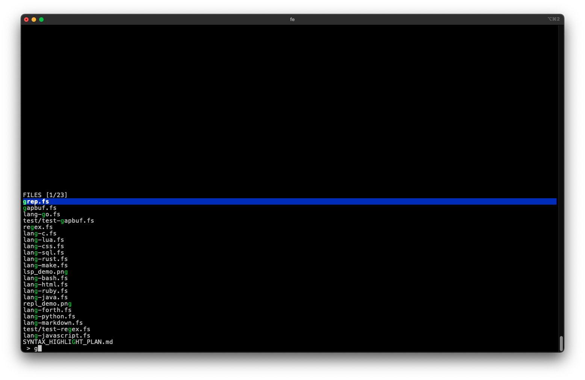
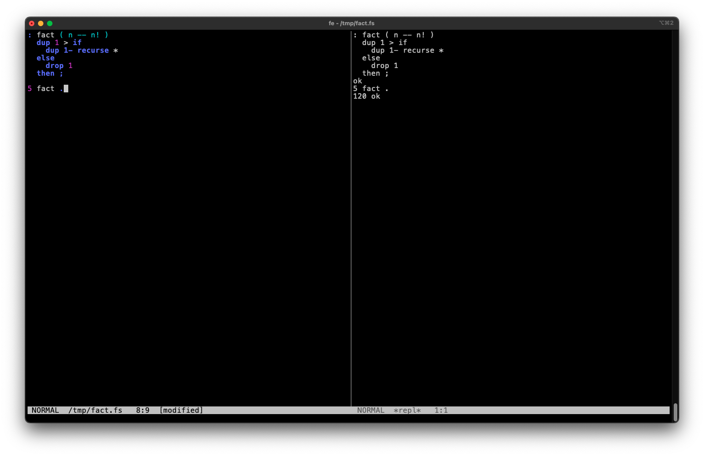
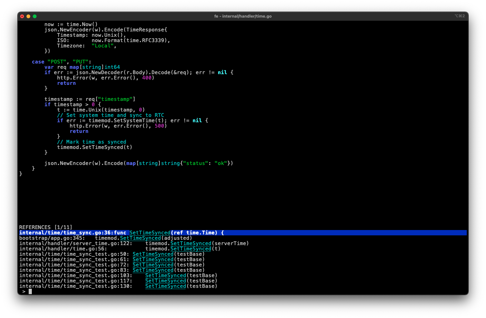

简体中文 | [English](README.md)

<p align="center">
  
</p>

# fe — 用 Forth 驱动、可现场编程的终端编辑器

`fe` 是一个跑在终端里、用 **Forth（Gforth）** 构建并可编程的编辑器。编辑器和 Forth 解释器在**同一进程、共享同一个词典**——你可以直接访问编辑器的内部词和变量，现场定义新命令。

与此同时，它提供了熟悉且完整的日常编辑体验：**vi 风格模式编辑**、模糊匹配筛选面板、异步 live grep、LSP 语言服务、多窗口分屏、撤销重做。

## 为什么是 fe？

三个鲜明的设计特点：

1. **Forth-native，而不是 Forth-themed。** 编辑器本身就是一个活的 Forth 系统。在 REPL 里可以直接调用编辑器的内部词和变量，也能用 `:` 现场定义新命令——不是“一个 C 程序套了层 Forth 皮”。
2. **熟悉、完整的日常工具。** vi 风格模式编辑、LSP、live grep、模糊文件/buffer 筛选、多窗口、撤销重做、键盘宏。用 Forth 并不意味着放弃普通编辑器的能力。
3. **编辑器本身可以被现场改造。** 配置、命令定义、按键绑定和扩展机制都是 Forth——它们是项目的核心理念，而不是实现细节。改一下 `~/.fe`，按 `Ctrl-x` 即重载。

- 依赖 **Gforth 1.0**（0.7.9 也可能可用） + 一个 C 编译器（仅首次运行编译 termios/宽度绑定时需要，之后走缓存）。
- live grep 需要 `rg` 或 `git` 或 `grep` 之一（`rg` 优先，没有则回退 `git grep` → `grep`）。
- 仅支持 macOS / Linux，ANSI / xterm 类终端。

---

## 安装

### 1. 安装 Gforth

**macOS**

```sh
brew install gforth
```

**Debian / Ubuntu**

```sh
sudo apt install gforth
```

装完确认版本（需要 1.0；0.7.9 也可能可用。若系统源里版本过旧，见下面「从源码编译」）：

```sh
gforth --version
```

**从源码编译（通用，任何 Linux）**

```sh
# 从 https://gforth.org 下载 gforth-1.0.0.tar.xz，解压后：
./configure
make
sudo make install
```

> 首次运行 fe 时，Gforth 的 libcc 会用本机 C 编译器编译几个小绑定（termios、wcwidth 等），
> 之后结果会被缓存，后续启动不再需要编译器。请确保 `cc`/`gcc`/`clang` 之一在 PATH 里。

### 2. 获取并运行 fe

```sh
cd forth                # fe.fs 所在目录
./fe                    # 启动（fe 是 fe.fs 的符号链接；fe.fs 是 shell/gforth 双重解释脚本）
./fe a.c b.txt          # 打开多个文件（停在第一个）

# 也可以直接：
./fe.fs a.c
# 或：
gforth fe.fs a.c
```

建议把 `fe` 链接到 PATH 里，例如：

```sh
ln -s "$PWD/fe" ~/bin/fe
```

---

## 配置（分层：`~/.fe` + `./.fe.fs`）

启动时（以及按 `Ctrl-x` 重载时）按优先级加载配置层：**`~/.fe`（用户）→ `./.fe.fs`（项目根目录，后者可覆盖）**。每一层都是一个 **Forth 片段**——可以设置变量、重新绑定按键：

```forth
4 tab-width !                          \ tab 显示宽度（默认 8）
0 linenr-default !                     \ 默认关闭行号（0=off 1=绝对 2=相对 3=hybrid）
1 regex-search !                       \ 搜索用 POSIX 正则（默认 0=字面子串）
1 lp-keep-right !                      \ 筛选面板超宽项改为保留右端（默认保留头部+尾部 …）
char Z ' cmd-qrep bind-command         \ 把「查询替换」改绑到 Z（配置是解释执行：用 char/' 而非 [char]/[']）
```

常用可配置变量：

| 变量 | 默认 | 说明 |
|---|---|---|
| `tab-width` | 8 | tab 的显示宽度 |
| `linenr-default` | 1 | 全局行号模式：0=off 1=绝对 2=相对 3=hybrid |
| `linenr-scope` | 0 | 行号模式作用域：0=每个窗口独立 1=每个 buffer 共享 |
| `regex-search` | 0 | 1=搜索用 POSIX 正则；0=字面子串 |
| `lp-keep-right` | 0 | 1=筛选面板超宽项保留右端 |

按键重绑用 `bind-command`（命令模式）、`bind-insert`（插入模式）、`bind-mode`（任意模式）。
单层配置出错会隔离（状态栏提示错误，不拖垮其它层）。

---

## 默认快捷键

### 命令模式（NORMAL，启动即在此模式）

| 键 | 功能 |
|---|---|
| `h` / `l` | 光标左 / 右（整字符，不跨行） |
| `k` / `j` | 光标上 / 下（按逻辑行，保留目标列） |
| `←` `→` `↑` `↓` | 方向键移动 |
| `Home` / `End` | 行首 / 行尾 |
| `PgUp` / `PgDn` / `Ctrl-f` / `Ctrl-b` | 上 / 下翻页 |
| `0` / `$` | 行首 / 行尾 |
| `w` / `b` / `e` | 下一词首 / 上一词首 / 词尾 |
| `gg` / `G` | 文件首 / 文件末 |
| `Ctrl-e` / `Ctrl-y` | 视口下滚 / 上滚一行（光标仅在越出视口时跟随） |
| `zz` / `zt` / `zb` | 光标滚到视口中心 / 顶 / 底（不动光标） |

| 键 | 功能 |
|---|---|
| `i` | 光标前进入插入模式 |
| `a` | 光标后进入插入模式 |
| `I` | 行首（首个非空白）进入插入模式 |
| `A` | 行尾进入插入模式 |
| `o` / `O` | 下方 / 上方开新行并进入插入模式（自动缩进） |
| `x` | 删除光标后字符 |
| `Delete` | 删除光标后字符 |
| `u` / `Ctrl-r` | 撤销 / 重做 |
| `p` / `P` | 粘贴到光标后 / 前 |
| `v` | 进入 / 退出视觉选择（移动键扩展选区，`ESC` 取消） |
| `y` | 复制：visual=选区；否则 `y`+motion（`yy`=整行） |
| `d` | 删除：visual=选区；否则 `d`+motion（`dd`=整行） |
| `c` | 修改：visual=删选区+进插入；否则 `c`+motion（`cc`=整行，`cw`/`c$`/`c%`） |
| `C` | 改到行尾（同 `c$`） |
| `D` | 删到行尾（同 `d$`） |
| `%` | 跳到配对括号（再按可来回跳） |
| `=` | 用外部 formatter 格式化当前 buffer |

| 键 | 功能 |
|---|---|
| `/` / `?` | 正向 / 反向搜索（增量；`n`/`N` 下一个/上一个，`~` 切换忽略大小写） |
| `E` | 查询替换（qemacs 风格，逐匹配单键确认） |
| `Q` / `@` | 开始/停止录制键盘宏 / 回放宏 |
| `Ctrl-s` | 保存 |
| `Ctrl-l` | 重绘 |
| `Ctrl-x` | 重新加载配置（`~/.fe`/`./.fe.fs`/键位） |
| `q` | 退出（有未保存修改时需二次确认） |

### 前缀键

| 前缀 | 第二键 |
|---|---|
| `g` | `g`=文件首，`d`=跳定义，`y`=跳类型，`r`=引用，`i`=实现，`s`=签名，`b`=跳回上一位置 |
| `z` | `z`=居中，`t`=到顶，`b`=到底 |
| `Ctrl-w` | 窗口命令（见「多窗口」） |

未命中的第二键会取消前缀模式。

### 插入模式（`i`/`a` 进入）

| 键 | 功能 |
|---|---|
| 任意可打印字符 | 插入（含 `q`/`h`/`j`/`k`/`l`/`x`；多字节字符） |
| `Tab` | 单词补全（无词前缀则插入制表符） |
| `Backspace` / `DEL` | 删除光标前字符 |
| `Delete` | 删除光标后字符 |
| `Enter` | 换行（复制当前行前导缩进） |
| `←` `→` `↑` `↓` / `Home` / `End` | 移动 |
| `PgUp` / `PgDn` / `Ctrl-f` / `Ctrl-b` | 翻页 |
| `Ctrl-s` | 保存 |
| `Ctrl-x` | 重新加载配置 |
| `ESC` | 返回命令模式 |

---

## 主要功能

### live grep（`\`）

按 `\` 打开异步 grep 面板：输入即重跑 `rg`（无 `rg` 时回退 `git grep` → `grep`）。

- `Enter`：跳转选中结果（到匹配列）
- `Ctrl-g`：把当前结果 dump 到 `*grep*` buffer（`path:line:` 前缀高亮，匹配字符绿色高亮，大小写不敏感）；在 `*grep*` 里按 `Enter` 跳转
- `ESC`：取消
- `Ctrl-g` 后面板结果进 `*grep*`，可继续用 `n`/`N` 或滚动浏览

### 文件 / buffer 筛选面板

- `Ctrl-o`：文件查找面板（递归列文件，输入即过滤，`Enter` 打开选中项，`Ctrl-j` 用输入的原路径打开或新建）
- `L`：buffer 筛选面板（输入即过滤，`Enter` 切换，`Delete` 关闭）

两个面板都用**模糊匹配**：空格分词、AND、按分降序，匹配字符绿色高亮。

<p align="center">
  
</p>

### 内嵌 Forth REPL（`Ctrl-g`）

`Ctrl-g` 打开/切换到 `*repl*` buffer——不是 shell，而是编辑器自身的 Forth 解释器（同进程、同字典），可以直接访问 fe 的词和变量、现场 `:` 定义新命令。

在 `*repl*` 里：

| 键 | 功能 |
|---|---|
| 任意字符 | 插入 Forth 源码 |
| `Enter` | 求值当前行，结果/错误追加到 buffer |
| `Tab` | 补全 Forth 词 |
| `↑` / `↓` | 回放历史 |
| `Backspace` / `DEL` | 删字符 |
| `ESC` | 回命令模式 |

在其他 buffer（命令模式）：`!` 表达式求值、`Ctrl-j` 求值当前行/选区——结果都追加到 `*repl*`。

REPL 里还能用 `locate <词>` / `view <词>`（打开源码并居中到词定义处）、`where <词>` / `browse <子串>`（多结果面板）、`see <词>`（反汇编）。

<p align="center">
  
</p>

### LSP 语言服务（`Ctrl-t`）

`Ctrl-t` 为当前文件启动语言服务器（gopls / pylsp / rust-analyzer / typescript-language-server / clangd 等，按扩展名映射）。

- 补全：插入模式 `Tab` 调度到 LSP（候选菜单有 kind 图标 + detail + live 预览，↑↓ 切换即时插入）
- 诊断：error/warn/info/hint 四色波浪线高亮
- 跳转：`gd` 定义、`gy` 类型、`gr` 引用、`gi` 实现（多结果面板，`path:line:content`）；`gb` 跳回
- 悬停 / 签名：`K` hover、`gs` 签名

<p align="center">
  
</p>

### 多窗口（`Ctrl-w`）

`Ctrl-w` 前缀进入窗口命令：

| 键 | 动作 |
|---|---|
| `v` / `s` | 垂直 / 水平分割 |
| `w` / `Ctrl-w` | 切到下一个窗口 |
| `h` / `j` / `k` / `l` | 方向焦点 |
| `c` | 关闭当前窗口 |

每个窗口有独立的光标 / 视口 / 模式（`:split` 语义）。

### 搜索 / 查询替换 / 宏

- 搜索：`/` `?` 增量搜索，`n`/`N` 重复，`~` 切换大小写，匹配反显高亮。
- 查询替换（`E`）：逐匹配 `y` 替换 / `n` 跳过 / `!` 全部 / `.` 替换并结束 / `q`/`Enter`/`ESC` 结束。
- 键盘宏：`Q` 录制、`@` 回放（单寄存器，记录按键序列）。

### undo / redo

`u` 撤销、`Ctrl-r` 重做。基于操作日志，连续同类型相邻操作自动合并（打一个词 = 一步撤销）。

### 退出保护

有未保存修改时按 `q` 不会直接退出，状态栏提示：

- 再按 `q` → 丢弃并退出
- `Ctrl-s` → 保存并退出
- 其他键 → 取消

---

## 配置示例

```forth
\ ~/.fe 示例
4 tab-width !               \ tab 宽 4
0 linenr-default !          \ 默认关行号
char Z ' cmd-qrep bind-command   \ 查询替换改到 Z
```

---

## 许可证

除依赖相关代码外，本项目的全部代码均以 **public domain** 发布（见 `LICENSE`，Unlicense 文本）。

依赖及第三方组件（各自遵循其许可证）：Gforth、`rg`/`git`/`grep`、各 LSP 服务器、外部 formatter（gofmt/rustfmt/prettier/clang-format 等）、`vendor/cJSON`（见 `vendor/cJSON-LICENSE`）。
